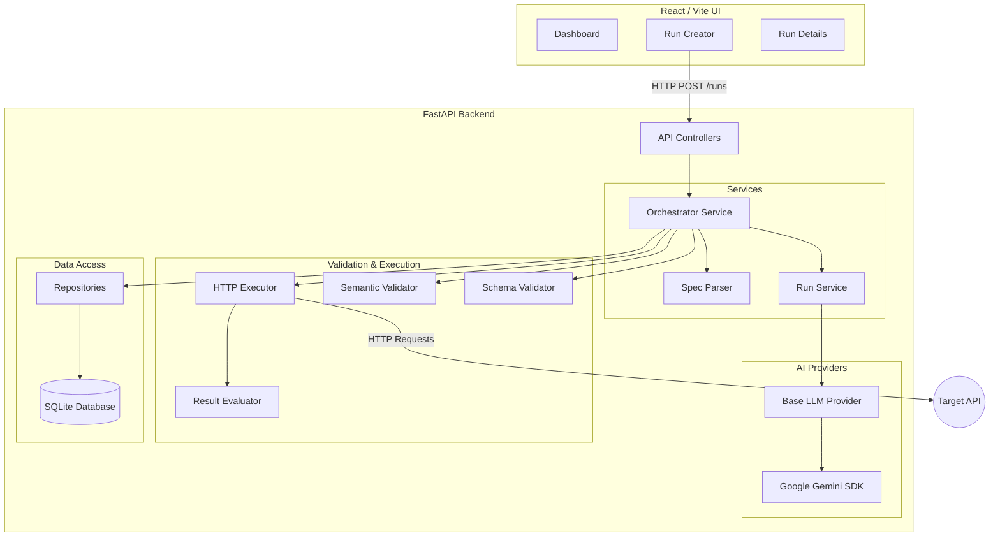

# Architecture: AI-Driven Test Automation Framework

## 1. High-Level Architecture Diagram

## 2. Layer Explanations

### Frontend Layer
- **Technology**: React 19, Vite, TailwindCSS 4, React Router.
- **Responsibility**: Provides the user interface to manage the test generation lifecycle. Connects to the backend REST API via Axios.

### API / Controller Layer
- **Technology**: FastAPI.
- **Responsibility**: Exposes HTTP endpoints for the frontend. Handles request parsing, Pydantic data validation, and routing requests to the appropriate service logic.

### Orchestration & Service Layer
- **Technology**: Pure Python logic (`app/services`).
- **Responsibility**: The heart of the application. `OrchestratorService` ties the asynchronous pipeline together. It controls the flow from LLM test generation to spec validation to HTTP execution. It abstracts complex multi-step processes away from the controllers.

### AI Integration Layer
- **Technology**: `google-genai` / AI Provider abstraction.
- **Responsibility**: Interfaces securely with external LLMs. Uses strict JSON schemas via Pydantic to ensure that the LLM output can be deterministically parsed into `TestCase` entities, protecting against unstructured textual hallucinations.

### Core Testing Engine (Validation & Execution)
- **Technology**: Async HTTP execution / Custom Logic.
- **Responsibility**:
  - **Validation**: `SchemaValidator` and `SemanticValidator` ensure the generated tests map perfectly to the OpenAPI document (e.g., verifying parameters and endpoints exist).
  - **Execution & Evaluation**: `HttpExecutor` safely runs valid tests against the target system. `ResultEvaluator` asserts if the application responded as the LLM predicted.

### Data Access Layer
- **Technology**: SQLAlchemy 2.0 ORM, SQLite (WAL mode).
- **Responsibility**: Encapsulates all SQL queries within Repository classes (`RunRepository`, etc.). This isolates the business logic from direct database interactions and allows for easier database migrations in the future.
